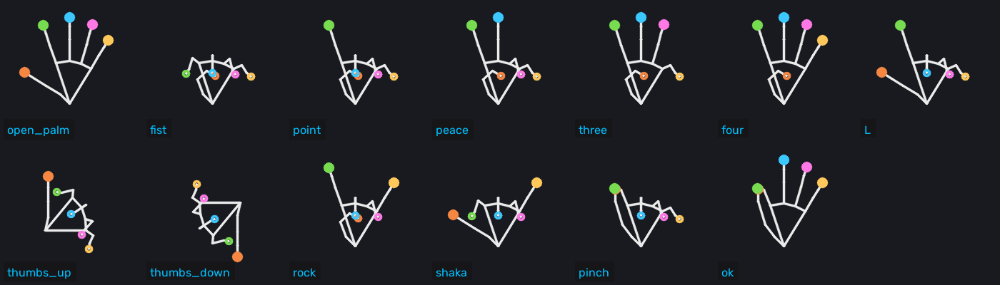

# 🖐 gesturectl — control your computer with your hands

Point a webcam at yourself and drive the desktop with hand gestures: flick through
Instagram Reels / YouTube Shorts, scroll with a peace sign, close windows, turn the
volume with an invisible knob, zoom with two hands, use your finger as a mouse, and
put the laptop to sleep with a closed fist.

Runs locally on the CPU (~25 ms per frame), works on **Windows, macOS and Linux (X11)**,
and every gesture is remappable in one YAML file.



## Quick start

```bash
cd GestureControl
python -m venv .venv && source .venv/bin/activate      # Windows: .venv\Scripts\activate
pip install -r requirements.txt
python -m gesturectl doctor          # checks camera, model, input permissions
python -m gesturectl run --dry-run   # try it: prints actions instead of doing them
python -m gesturectl run             # the real thing
```

The 7.5 MB MediaPipe hand model downloads automatically the first time. A small preview
window shows what the system sees; press **h** in it for the live gesture list.

> **macOS:** allow *Camera* and *Accessibility* for your terminal in System Settings → Privacy & Security.
> **Linux:** use an Xorg session. On Wayland, injected input only reaches XWayland apps.

## Default gestures

**Everywhere**

| Gesture | Action |
|---|---|
| ✊ hold fist **2.5 s** (red ring fills up) | 😴 **sleep** the computer |
| 🤙 hold shaka 1 s | pause / resume gesture control |
| 👆 hold "L" (thumb + index) 1 s | next mode: desktop → reels → mouse |
| 🙌 both palms open | show desktop (the "boss key") |
| 👌👌 both hands pinch, pull apart / together | zoom in / out |
| two "L" hands (a picture frame) | screenshot |

**Desktop mode**

| Gesture | Action |
|---|---|
| 🖐 swipe up / down | task view / minimise window |
| 🖐 swipe left / right | next / previous virtual desktop |
| four fingers swipe left / right | next / previous browser tab |
| ✌️ hold, then move the hand up / down | scroll (joystick: the further you move, the faster it scrolls) |
| 🤟 hold three fingers 0.8 s | **close window** |
| 👌 hold OK 0.8 s | maximise window |
| ☝️ hold 0.9 s | switch app (Alt+Tab) |
| 👍 / 👎 | play-pause / mute |
| 🤏 pinch and twist like a knob | volume up / down |
| 🤘 hold 1 s | **open Instagram Reels** and switch to reels mode |

**Reels mode** (Instagram Reels, YouTube Shorts, TikTok web)

| Gesture | Action |
|---|---|
| 🖐 flick up / down | next / previous reel |
| 👍 hold | ❤️ like (double-tap) |
| 🖐 hold still 0.8 s | pause / play |
| 🤏 twist | volume |
| 🤟 hold three fingers | close the tab, back to desktop mode |

**Mouse mode**: your knuckle moves the cursor · pinch = click, or hold the pinch to drag ·
thumb + middle pinch = right-click · ✊ = clutch (freeze the cursor) · ✌️ = scroll.

## Make it yours

```bash
mkdir -p ~/.config/gesturectl
cp gesturectl/default_config.yaml ~/.config/gesturectl/config.yaml   # then edit
python -m gesturectl gestures        # check the result
```

```yaml
modes:
  desktop:
    - {gesture: rock, hold: 1.0, action: "open:https://youtube.com/shorts"}
    - {gesture: thumbs_up, repeat: 0.25, action: volume_up}     # auto-repeat while held
    - {gesture: peace, tap: 0.4, action: "hotkey:ctrl+shift+t"}  # quick flash = reopen tab
```

**Teach it a new gesture** in about 4 seconds:

```bash
python -m gesturectl train spiderman      # show the pose, move it around a little
```

Then bind it: `{gesture: "custom:spiderman", hold: 0.6, action: screenshot}`.

## Other commands

| Command | What it does |
|---|---|
| `run --record s.jsonl` | record hand landmarks (no video) for debugging |
| `replay s.jsonl` | replay a recording through the engine, for example after changing thresholds |
| `run --camera clip.mp4 --dry-run` | run on a video file instead of the webcam |
| `annotate photo.jpg -o out.png` | detect poses in a photo and draw the HUD |
| `run --mode reels --paused` | start in a given mode, paused until 🤙 |

## Tests

```bash
pytest -q                                                   # 300 tests, no camera needed
xvfb-run -a pytest -q                                       # + end-to-end: video -> real X11 keystrokes
```

How it works, and why it is built this way: **[docs/TECHNICAL.md](docs/TECHNICAL.md)**.
