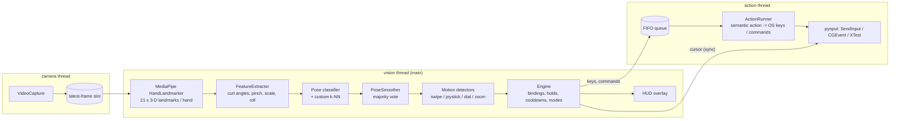
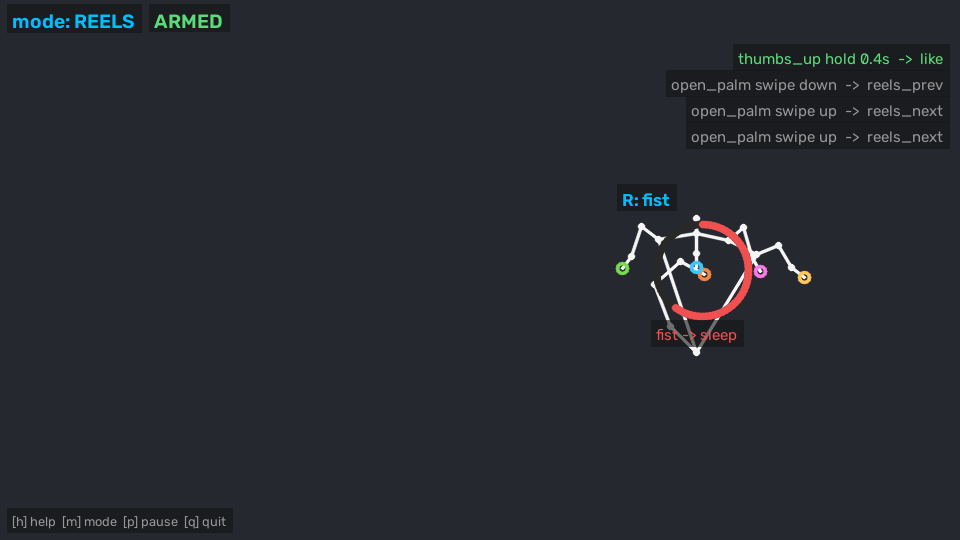
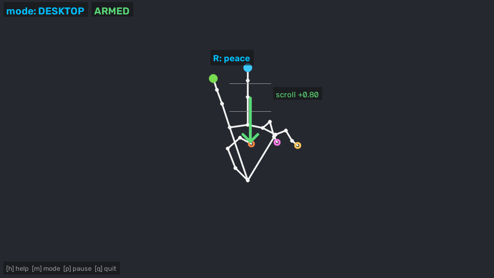

# gesturectl: technical design

This document explains how gesturectl turns webcam frames into desktop actions. It
covers the system design and the maths behind each stage, how every threshold was
chosen, how the system was tested, and where it still falls short.

---

## 1. Goals and constraints

| Goal | What it means for the design |
|---|---|
| **Fast enough to feel direct** | The whole loop, from camera to keystroke, must stay well under 100 ms. No server, no GPU required. |
| **Works for anyone, anywhere in the frame** | Every feature must ignore hand size, distance from the camera, camera resolution and (mostly) hand rotation. |
| **Never does something you didn't mean** | The "Midas touch" problem: a hand that is always visible must not trigger actions just by moving around. Dangerous actions (sleep, close) must be hard to trigger by accident. |
| **Cross-platform** | One gesture vocabulary that maps to the right keys on Windows, macOS and Linux. |
| **Hackable** | All bindings in YAML. Users can teach new poses without writing code. |
| **Testable without a camera** | Everything except the camera and the model is pure logic with injected time and I/O. |

---

## 2. Architecture



It runs on three threads, each for a specific reason:

1. **Camera thread.** OpenCV's `read()` returns the *oldest* buffered frame. If inference
   is even slightly slower than the camera, a backlog builds up and the system feels laggy.
   The camera thread keeps overwriting a single "latest frame" slot, guarded by a
   `threading.Condition`, so the vision loop always works on the newest image and stale
   frames are dropped instead of queued.
2. **Vision thread.** Runs inference and all gesture logic in order. Everything after
   MediaPipe takes about 0.44 ms per frame.
3. **Action thread.** Opening a URL, or running `systemctl suspend`, can block for hundreds
   of milliseconds. Actions go through a FIFO queue, so order is kept and the camera never
   stutters. Cursor movement is the exception: it is sent directly, because any delay there
   is felt immediately.

### Module map

| Module | Responsibility |
|---|---|
| `camera.py` | Threaded capture, mirroring, video-file playback at native fps |
| `tracker.py` | MediaPipe Tasks wrapper, model auto-download (atomic), handedness fix-up |
| `landmarks.py` | Landmark topology and the `Hand` container (isotropic, normalised and world coordinates) |
| `features.py` | Geometry: joint curl, pinch, thumb direction, palm scale and roll, with hysteresis |
| `poses.py` | Rule-based pose classifier and the temporal `PoseSmoother` |
| `motion.py` | `SwipeDetector`, `Joystick`, `Dial`, `PinchZoom` |
| `filters.py` | One Euro filter and a Schmitt trigger (`Hysteresis`) |
| `engine.py` | Binding semantics: hold, repeat, tap, swipe, joystick, dial, zoom, mouse; modes, pause, cooldowns |
| `actions/` | Semantic action → per-OS hotkey or command; pynput and dry-run backends |
| `custom.py` | Few-shot k-NN classifier for user-trained poses, with open-set rejection |
| `config.py` + `default_config.yaml` | Deep-merged YAML config with validation and helpful errors |
| `hud.py` | On-screen feedback: skeleton, progress rings, joystick, event log, help |
| `recorder.py` | Landmark-only session recording and replay |
| `synthetic.py` | Forward-kinematics hand generator used by the tests and the docs figures |

---

## 3. Stage 1: hand landmarks (MediaPipe)

`HandLandmarker` (MediaPipe Tasks API, `hand_landmarker.task`, float16, about 7.5 MB) is a
two-stage pipeline:

1. A **palm detector** (single-shot detector). Palms are rigid and roughly square, so they
   are much easier to detect than whole hands with moving fingers.
2. A **landmark regressor** that runs on the cropped palm region and outputs 21 keypoints.
   For each keypoint you get normalised image coordinates *and* metric "world" coordinates
   (in metres, centred on the hand), plus a handedness label.

In **VIDEO mode**, MediaPipe reuses the previous frame's landmarks to place the next crop.
The expensive detector only runs again when tracking is lost, which is why it reaches
real-time speed on a laptop CPU. VIDEO mode requires strictly increasing timestamps, and
`tracker.py` enforces that.

**Two practical details:**

* The old `mp.solutions.hands` API has been **removed** from current MediaPipe releases
  (this project was built against MediaPipe 1.2.3). gesturectl uses the Tasks API and
  downloads the model on first run, to a temporary file that is then atomically renamed,
  so an interrupted download never leaves a corrupt model behind.
* MediaPipe labels handedness **assuming a mirrored (selfie) image**. The camera thread
  mirrors frames by default, so labels match your real hands. If mirroring is turned off,
  the tracker swaps the labels.

### Coordinate systems

Every `Hand` carries three versions of the same 21 points:

| Field | Units | Used for |
|---|---|---|
| `norm` | MediaPipe normalised: x, y ∈ [0, 1] | Mapping to screen pixels (mouse), drawing |
| `image` | **Isotropic**: x multiplied by the aspect ratio, so 1 unit = frame height on both axes | Motion: swipes, joystick, roll angle |
| `world` | Metres, hand-centred, 3-D | Shape: finger angles, pinch distance |

The isotropic conversion matters. On a 16:9 camera, raw normalised x and y have different
units, so a circle looks like an ellipse and angles are distorted by up to 44 %.

---

## 4. Stage 2: feature engineering

Rule: **every feature is an angle or a ratio**, never a raw distance. That makes it
independent of camera distance and resolution.

### 4.1 Finger curl

For each finger, take the chain wrist → MCP → PIP → DIP → TIP and sum the bend at the
three inner joints:

```
curl(finger) = Σ over joints j in {MCP, PIP, DIP} of (180° − ∠(P[j-1], P[j], P[j+1]))
```

A straight finger scores about 0°. A tight fist scores 200–240°. The angles are computed on
the **3-D world landmarks**, so turning the hand in any direction does not change them. A
naive "is the fingertip above the knuckle?" test breaks as soon as you tilt your hand.

### 4.2 Calibration data

Thresholds were not guessed. They were measured on real photos run through MediaPipe
(Google's public gesture-recogniser sample images):

| Photo | Finger | Curl | Tip-to-wrist / palm length |
|---|---|---|---|
| pointing up | index (extended) | 53° | 2.06 |
| pointing up | middle / ring / pinky (folded) | 201° / 206° / 190° | 0.75–0.90 |
| victory | index / middle (extended) | 54° / 40° | 2.11 / 2.34 |
| victory | ring / pinky (folded) | 148° / 156° | 0.88–1.19 |
| thumbs up | thumb (extended) | 24° | — |
| thumbs up | four fingers (folded) | 146–171° | 0.86–1.08 |
| thumbs down | thumb (extended) | 20° | — |
| pointing / victory | thumb (folded) | 86° / 105° | — |

Extended fingers sit at **40–55°** and folded fingers at **≥ 145°**. That leaves a wide empty
band, and the thresholds go inside it, with **hysteresis** (a Schmitt trigger):

| | Turns *extended* below | Turns *folded* above |
|---|---|---|
| Fingers | 105° | 125° |
| Thumb | 68° | 82° (extended thumbs measure ≤ 38°, folded ≥ 86°) |
| Pinch (thumb tip to index tip, in palm lengths) | 0.22 | 0.32 |

Hysteresis means a finger sitting right on a threshold cannot flicker between states.
Once it is extended, it has to bend clearly further before it counts as folded.

### 4.3 Measurement noise always adds bend

The first thumb threshold (55°) failed the noise tests. Investigating showed a systematic
bias: each joint's bend is an *unsigned* angle, so random landmark noise can only make a
straight finger look **more** bent, never less. With about 2 mm of noise on every
landmark, a perfectly straight synthetic thumb (true curl 13°) measured a **median of 44°
and a 95th percentile of 73°**. The thumb has the shortest segments, so it suffers most.
The thumb band was moved up to 68° / 82°, still well inside the gap seen in the real
photos (38° to 86°).

### 4.4 Other features

* **Pinch**: thumb-tip to index-tip distance divided by palm length. It is gated by
  *index reach* (wrist to index tip > 1.1 palm lengths), because in a fist the curled
  index finger can rest right next to the thumb tip. A real pinch keeps the index
  finger reaching out.
* **Thumb direction**: angle of the thumb's MCP → tip vector *in the image*. This uses the
  image rather than the world frame on purpose: "up" means up relative to gravity and the
  camera, not relative to the hand.
* **Palm scale**: wrist to middle-finger MCP, in isotropic image units. Every motion
  measurement is divided by this.
* **Roll**: in-plane angle of the wrist → middle-MCP vector, used by the volume dial.

---

## 5. Stage 3: pose classification

### 5.1 Rules

Thirteen poses are recognised by an ordered decision list over the five finger states, plus
pinch and thumb direction:

```
pinching?                       -> ok (if middle, ring, pinky extended) else pinch
no long fingers extended?       -> thumbs_up / thumbs_down (thumb out, pointing within 50° of vertical) else fist
all four long fingers?          -> open_palm (with thumb) / four (without)
index only                      -> L (thumb out) / point
index + middle                  -> peace
index + middle + ring           -> three
index + pinky                   -> rock
thumb + pinky                   -> shaka
```

Why rules instead of a trained network? They need **zero training data**, are explainable
("your ring finger reads as extended"), are cheap, and are easy to extend. Learning is still
available for *personal* gestures through the k-NN layer (§9).

### 5.2 Temporal smoothing

A single bad frame (motion blur, a finger hidden for a moment) should not change the pose.
`PoseSmoother` keeps the last 5 labels and only switches when a new label holds a
**quorum of 3**. That adds about 2 frames (≈ 66 ms) of delay in exchange for no flicker.

### 5.3 Robustness results (automated tests)

| Condition | Result |
|---|---|
| 13 poses × {left, right} × palm size {8 %, 18 %, 35 % of frame height} × roll {−25°, 0°, +25°} | **234 / 234** correct |
| Every pose with Gaussian noise of 0.025 palm lengths (~2 mm) on every landmark, a single frame, 500 trials | ≥ **90.6 %** each (worst: open_palm, shaka, L, thumbs; all thumb-dependent) |
| Same noise, streaming (hysteresis + smoother), 1,000 frames per pose | **100 %** for every pose |
| Real photos: thumbs up, thumbs down, victory, pointing | **4 / 4** correct |

---

## 6. Stage 4: dynamic gestures

All motion is measured in **palm lengths**, not pixels, so a swipe is the same gesture at
40 cm and at 1.5 m from the camera.

### 6.1 Swipe detector

```
buffer  = last 300 ms of (t, palm centre, palm scale, pose)
d       = (centre_now − centre_oldest) / mean(scale)
fire if |d| ≥ 1.1 palm lengths
     and |d| / Δt ≥ 3.5 palm lengths per second
     and the dominant axis is ≥ 1.8× the other axis   (diagonals are ignored)
```

**Return-stroke suppression.** After you flick up, your hand naturally comes back down,
and that return looks exactly like a swipe down. After each swipe the detector goes quiet
for 450 ms and blocks the **opposite** direction for 900 ms. A *same-direction* swipe after
the quiet period still works, so you can flick through reel after reel. The swipe's pose is
the majority pose across the buffer, because poses blur during fast motion.

### 6.2 Joystick scrolling

Instead of mapping hand movement to scroll movement (which makes you "ratchet" your hand),
✌️ works like a **rate-controlled joystick**. When the pose starts, the hand's height
becomes the anchor, and from then on:

```
offset = (y − anchor_y) / palm_scale
rate   = 0                                  if |offset| < 0.25   (dead zone)
       = min(14 · (|offset| − 0.25)^1.6, 40) ticks per second, signed
```

The power curve gives fine control near the anchor and fast scrolling further out.
Fractional ticks build up in an accumulator, so slow scrolling is smooth instead of jumping.

### 6.3 Volume dial

While pinching, the hand's in-plane rotation (roll) is tracked. The angle is **unwrapped**
(each change is folded into (−180°, 180°]), so crossing ±180° does not cause a jump. Each
18° of turn is one volume step. A frame-to-frame change above 60° is treated as a tracking
glitch and ignored.

### 6.4 Two-hand pinch zoom

The distance between the two hands' pinch points, divided by palm scale, is compared to a
reference. Each 18 % increase is one zoom-in step (and the reference resets); each matching
decrease is one zoom-out step.

---

## 7. Stage 5: the engine (from gestures to intent)

### 7.1 Which hand is in control?

* Hands smaller than **7 % of the frame height** are ignored (people walking behind you).
* The **largest** hand, which is the one closest to the camera, is the primary hand.
* If two hands show the same two-hand pose, **two-hand bindings win the frame** and all
  single-hand processing is skipped. Otherwise "both palms open" would also be read as a
  single open palm.

### 7.2 Trigger types

| Trigger | Semantics |
|---|---|
| `hold: s` | Fires once after the pose has been held for *s* seconds **while the hand is still** (speed < 2 palm lengths/s). Moving restarts the countdown. A 150 ms grace period covers brief tracking dropouts. Fires again only after the pose is released. |
| `repeat: s` | Fires after a 200 ms debounce, then every *s* seconds while the pose is held. |
| `tap: s` | Pose shown and then *changed* within *s* seconds. |
| `swipe: dir` | See §6.1. A swipe also cancels any hold that was building up. |
| `joystick`, `dial`, `zoom`, `mouse` | Continuous controllers, active while the pose is held. |

### 7.3 Safety

* **Hold-to-confirm, with a visible countdown.** Sleep needs a *still* fist for 2.5 s, and
  the HUD fills a red ring as the time passes. Closing a window needs 0.8 s.
* **Holds can never "resume".** Any hold that was not evaluated in a frame (other mode,
  paused, hand gone) is deleted, so its next attempt starts from zero. Without this, a fist
  held before pausing could put the computer to sleep the moment you un-paused.
* **Pause.** 🤙 held for 1 s disarms everything except the un-pause binding.
* **Cooldown.** The same action cannot fire twice within 350 ms. Continuous controllers
  are exempt.
* **Gesture conflicts are resolved explicitly.** In mouse mode ✊ is the clutch (rest your
  hand), so the global "fist → sleep" binding carries `except_modes: [mouse]`. This conflict
  was found while reviewing the engine and is now covered by a regression test.
* **Dry-run mode.** `run --dry-run` prints actions instead of performing them.

### 7.4 Modes

Bindings belong to a mode (`desktop`, `reels`, `mouse`, or any you define) or to `global`.
Actions can switch modes: `mode:reels`, `next_mode`. One binding can run a list of actions,
so 🤘 runs `["open:https://www.instagram.com/reels/", "mode:reels"]`: it opens Reels *and*
changes the gesture map to match.

---

## 8. Air mouse

* **Anchor point: the index knuckle (MCP), not the fingertip.** When you pinch to click,
  the fingertip moves towards the thumb, so a fingertip-driven cursor would slide off its
  target exactly when you click. The knuckle barely moves during a pinch.
* **Click freeze.** For 120 ms after a pinch starts or ends, the cursor is held still, to
  absorb whatever drift is left.
* **Active region.** The central part of the camera frame (x 22–78 %, y 18–68 %) maps to the
  whole screen, so you can reach the corners without your hand leaving the camera's view.
* **One Euro filter** (Casiez et al., CHI 2012): a low-pass filter whose cutoff adapts to
  speed:

  ```
  α(fc)   = 1 / (1 + τ/Δt),   τ = 1 / (2π·fc)
  dx̂      = lowpass(dx/dt, d_cutoff)
  fc      = min_cutoff + β·|dx̂|
  x̂       = lowpass(x, fc)
  ```

  Holding still gives a low cutoff, so jitter disappears. Moving fast gives a high cutoff,
  so there is no lag. With the shipped settings (min_cutoff 0.8 Hz, β 4.0), the tests show
  frame-to-frame jitter cut by **6.3×**, with a position lag of 1.7 % of the travel at the
  end of a 2-second full-screen move.
* **Pinch = mouse button.** Pinch-down presses the button and release lets it go, so
  drag-and-drop works. Thumb + middle finger pinch is right-click. A ✊ fist is a *clutch*:
  the cursor freezes so you can rest your hand.

---

## 9. Custom gestures (few-shot learning)

`gesturectl train <name>` records about 120 frames (about 4 s). Each frame is turned into a
63-number vector:

1. Move the 3-D world landmarks so the wrist is at the origin.
2. Mirror left hands onto right hands.
3. Divide by palm length.

The vector keeps orientation (thumbs up ≠ thumbs down) but ignores position, distance and
which hand is used. Classification is **k-nearest-neighbours** (k = 5) with **open-set
rejection**: a prediction counts only if ≥ 60 % of the neighbours agree *and* their mean
distance is below a threshold taken from the training data itself (95th percentile of
leave-one-out nearest-neighbour distances × 3, plus a margin). Hand shapes that are nothing
like any trained gesture return "unknown" instead of being forced into the nearest class.
A confident custom match overrides the built-in classifier.

---

## 10. Actions: one vocabulary, three operating systems

Bindings name **what** to do (`close_window`), not **which keys** to press. `actions/__init__.py`
holds the per-OS table:

| Action | Windows | macOS | Linux |
|---|---|---|---|
| `close_window` | Alt+F4 | ⌘W | Alt+F4 |
| `show_desktop` | Win+D | ⌘F3 | Super+D |
| `task_view` | Win+Tab | Ctrl+↑ (Mission Control) | Super |
| `next_desktop` | Ctrl+Win+→ | Ctrl+→ | Ctrl+Alt+→ |
| `screenshot` | Win+PrtSc | ⌘⇧3 | PrtSc |
| `sleep` | `rundll32 powrprof.dll,SetSuspendState 0,1,0` | `pmset sleepnow` | `systemctl suspend` |
| `lock` | `rundll32 user32.dll,LockWorkStation` | `pmset displaysleepnow` | `loginctl lock-session` |
| `volume_up`, `play_pause` | media keys | media keys | media keys (XF86) |
| `reels_next` / `reels_prev` | ↓ / ↑ (works on Instagram Reels, YouTube Shorts and TikTok web) | | |
| `like` | double-click the centre of the screen (double-tap to like) | | |

Raw escapes are still available: `hotkey:ctrl+shift+t`, `key:space`, `open:<url>`,
`type:<text>`, `scroll:<n>`, and `run:<command>`. `run:` is **off by default**
(`actions.allow_run`), so a config file shared by someone else cannot run arbitrary commands.

pynput injects input through **SendInput** on Windows, **Quartz CGEvent** on macOS and the
**XTest** extension on X11. Every action runs inside a try/except, so one failing action is
logged and the loop keeps going.

---

## 11. Feedback (HUD)

A gesture interface without feedback feels random. The preview window draws:

* the skeleton, with extended fingertips shown as filled dots and folded ones as rings;
* the smoothed pose, plus the raw pose in brackets when they differ (useful for tuning);
* **hold-to-confirm rings**, red for dangerous actions;
* the joystick anchor, dead-zone band and live scroll offset, and the dial angle;
* the last five actions, and the mode and armed/paused state;
* a help overlay (**h**) listing the current mode's bindings with their per-OS meaning.




---

## 12. Testing strategy

| Layer | How | Count |
|---|---|---|
| Geometry and poses | **Forward-kinematics synthetic hands** (`synthetic.py`) cover every pose × hand × size × rotation, plus noise, filter and k-NN tests | 253 |
| Motion | Generated trajectories: fast vs slow, diagonal, return strokes, hand-size normalisation, joystick curve, dial wrap-around | 9 |
| Engine scenarios | 30 fps simulated sessions through the real engine with a recording backend. Examples: "fist released at 1.5 s does nothing", "pause blocks sleep", "background hands ignored", "two palms suppress single-hand gestures", "resting a fist in mouse mode never sleeps the laptop" | 21 |
| Config and actions | Validation errors, per-OS resolution, `run:` opt-in | 13 |
| Real photos | MediaPipe on real images → expected pose | 4 |
| **End to end** | A video built from real photos goes through `gesturectl run --camera video.avi`; a **pynput keyboard listener on an X server** confirms that `media_play_pause` and `Alt+Tab` actually arrived | 1 |

`pytest -q` runs the 300 tests that need no display in about 3 s, with no camera.
`xvfb-run -a pytest -q` adds the X11 end-to-end test. Both run in GitHub Actions
(`.github/workflows/gesturectl.yml`).

The synthetic generator is a small piece of forward kinematics: it places the MCP joints on
a palm, chains bone segments with joint bend angles, and applies rotation, scale,
mirroring and Gaussian noise. That gives exact ground truth for any pose, which is
impossible to get from a webcam.

---

## 13. Performance

Measured on a 4-core cloud VM, CPU only, 960 × 540 frame, two hands:

| Stage | Time |
|---|---|
| MediaPipe `HandLandmarker` (VIDEO mode) | median **25.4 ms**, p95 32.7 ms → up to about 39 fps |
| Everything else (features, poses, motion, bindings) | **0.44 ms** per frame |
| Pose smoothing delay | about 2 frames (66 ms at 30 fps) |

The model is effectively the only cost. The default 960 × 540 capture is a deliberate
compromise: MediaPipe resizes internally anyway, and smaller frames are cheaper to decode
and convert.

---

## 14. Limitations and future work

* **Wayland.** Synthetic input on Wayland goes through compositor-specific portals. A
  `ydotool` / libei backend would fix it; for now use an X11 session.
* **Focus.** Keystrokes go to whichever window has focus. The preview window is set to
  always-on-top but does not take focus. Click your browser once after starting.
* **Lighting.** Strong backlight (a window behind you) lowers MediaPipe's confidence. Light
  your hands from the front.
* **Fixed thresholds.** Very large or very small hands, or limited finger mobility, may need
  tuning. A guided `calibrate` command that records your own open/closed extremes and sets
  the hysteresis bands would be the natural next step.
* **Learned dynamic gestures.** Swipes are hand-written detectors. A small temporal model
  (a 1-D CNN or GRU over landmark sequences) could learn circles, waves and letters, trained
  on `--record` sessions.
* **Multiple monitors.** The air mouse maps to the primary screen.
* **GPU.** MediaPipe Tasks supports a GPU delegate. Exposing it as an option would free CPU
  on supported machines.

---

## 15. How it was built

1. **Environment check.** The installed MediaPipe (1.2.3) no longer has `mp.solutions`, so
   the code was written against the Tasks API from the start. The container also needed
   EGL/GLES system libraries (`libegl1`, `libgles2`) before MediaPipe would load. These are
   listed in the CI workflow.
2. **Measure before choosing thresholds.** The first real code was a probe that printed curl,
   reach and thumb geometry for real photos (§4.2). The thresholds came from that table.
3. **Build the pipeline bottom-up.** Each module is pure and tested on its own: filters →
   features → poses → motion → engine → actions.
4. **A synthetic hand generator** made it possible to test the whole system without a camera,
   including the timing (holds, cooldowns, return strokes).
5. **Bugs the tests caught:** the noise bias in thumb curl (§4.3); taps that never fired
   because "hand vanished" was not treated as a release; two frames of cursor drift when
   clutching (an accepted cost of smoothing, now documented); and OpenCV's ASCII-only font
   drawing `→` as `?` in the HUD.
6. **End-to-end proof on a real display server** (§12). Real photo frames went in, and the
   X server received real keystrokes.
